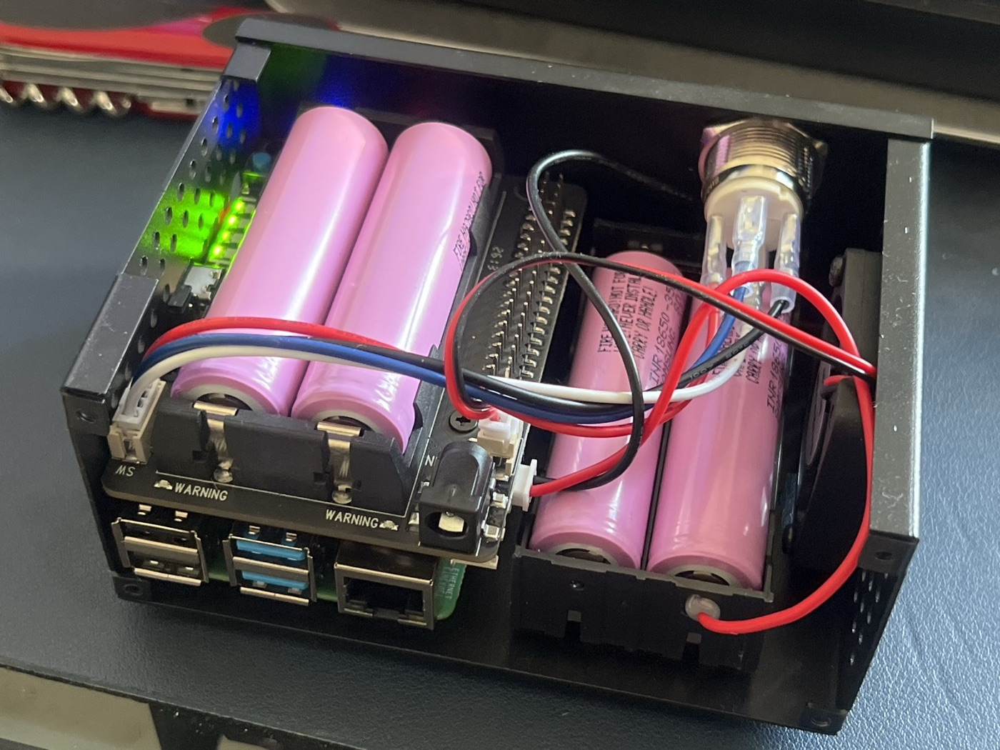

# 9. Power

Script: [`installation/07-energie.sh`](../installation/07-energie.sh)

## The problem

The station runs on an ordinary **USB power bank** (the project uses an Anker 737, about 86 Wh). Such a battery **does not tell the Pi how full it is**: it gives 5 volts, then cuts off at once. A computer switched off brutally can damage its memory card. So rather than predicting the end of the battery, the station is made **safe to cut**, and it switches itself off cleanly when it can see trouble coming.

```
Pi$ cd ~/installation
Pi$ sudo bash 07-energie.sh
```

## 9.0 The battery case (X728)

*Added November 2026.* The station now runs in a **Geekworm X728-C1** metal case with an **X728 V2.5** battery board and four 18650 cells ([hardware](../HARDWARE.md#geekworm-x728-and-its-x728-c1-case)). The power bank becomes optional.



**Assembly, from bottom to top:**

1. **Charge the four cells fully** first, all to the same level (about 4.2 V each). Nothing is plugged in, no cell in place.
2. **Feet:** a flat-head screw goes through the bottom of the case from outside (its head sits flush), and a short 5 mm spacer screws onto it inside. Four of them. Skip this on a table test.
3. **The Pi** sits on the four short spacers.
4. **Long spacers:** push the threaded end of each long spacer through a hole of the Pi, from above, and screw it into the short spacer below. The Pi is clamped between them.
5. **The X728** plugs onto the Pi's 40 pins (check that no pin is left outside), and rests on the long spacers. Round-head screws hold it from above.
6. **Cables**, still without cells: the extra cell holder, the push button and the fan. Each plug only fits its own socket: never force one.
7. **Cells last**, flat end (−) against the spring.
8. **Power** now plugs into the X728's input, never into the Pi.

**Tested:** the station boots on the X728 and runs its updates without a single undervoltage alert (`vcgencmd get_throttled` = `0x0`), 44 °C in the closed case with its fan.

**The software** (step 12):

```
Pi$ cd ~/installation
Pi$ sudo bash 12-batterie.sh
```

The service `prometheus-batterie` reads the X728's charge gauge (I2C address `0x36`) and the mains pin, every 10 seconds:

- *Settings > Station health* shows the charge, whether the station is **on mains or on batteries**, and on batteries the time left (see below);
- on batteries, when the cells are down to **5 %** or **3.35 V** for 60 seconds in a row, the station **shuts down cleanly**; below 3.20 V it does so whatever the mains pin says;
- at the very end of any shutdown (not a restart), a 4-second pulse on pin 26 asks the X728 to **cut the power**, so a switched-off station does not keep draining its cells;
- the X728's button: short press = restart, long press = shut down;
- one line per minute in `/var/lib/prometheus-batterie/journal.csv` (time, mains or batteries, volts, percent), plus a line at each start and at each shutdown it decides itself (cells low, button): the record of a battery-life test. Nobody needs to watch: afterwards, `sudo prometheus-batterie --bilan` sums up the last run on batteries in plain words (start, clean shutdown or not, last reading, battery life, charge when switched back on);
- the X728's **clock** (a DS1307 at I2C address `0x68`, kept running by the cells while the station is off) puts the station on time at boot, **even without internet**: the Pi has no clock of its own and would otherwise restart at the time it was switched off. The program `prometheus-horloge` reads it very early at boot (`dtoverlay=i2c-rtc,ds1307` in `/boot/firmware/config.txt`, a restart after step 12 the first time); the time from internet is copied into it every hour, at shutdown, and by the system every 11 minutes. A brand-new board has no time yet: it gets one the first time the station is online.

**Time from the radio**, as a last resort: no internet for a long time and no board clock (no X728, or its cells removed), but the radio still hears other radios. Each MeshCore announcement and each Meshtastic position carries the time of the radio that sent it. One radio alone is never believed (many repeaters have a wrong clock): the station needs **at least two different radios agreeing within 2 minutes, and more than half of those heard** in the last 2 hours; the station's own T-Beam counts alone only when its GPS sees satellites (Meshtastic). The clock is never set back (a station without a sure time restarts at the time it was switched off: the real time cannot be earlier). `prometheus-radio` (no rights) leaves a request in `/run/prometheus/heure-radio.json`; `prometheus-horloge --radio` (root, installed by step 10, so it works without an X728 too) checks everything again, sets the station's time and the board's clock. While its time is not sure, the station no longer gives its time to its radio, and it no longer takes a visiting phone's time once it has a sure one. Where the time came from: `/run/prometheus-heure` (`carte` = board, `radio`), or internet when `/run/systemd/timesync/synchronized` exists. The full order of the sources: [step 5](05-portal-and-hotspot.md#the-clock).

**Time left on batteries.** The X728's percentage is not reliable: during our test it fell by 5 % an hour in the morning and 17 % an hour in the evening, while the voltage went down steadily. So the time left is read from the **voltage**, on the curve measured during that test, and adjusted after 20 minutes to how fast the cells are really going down (more phones connected = faster). Replayed on the test: 4 % off in the middle case, 9 % at worst nine times out of ten (the old estimate from the percentage was off by up to three times).

X728 V2.x pins: 5 (the board asks for a shutdown), 6 (mains lost = 1), 12 (set high: "the Pi is up"), 26 (ask the board to cut the power). None is used by the e-ink screen. Without an X728, the service stops at once and does nothing.

To try the shutdown rule without switching anything off (stop the service first: pins are not shared):

```
Pi$ sudo systemctl stop prometheus-batterie
Pi$ sudo PROMETHEUS_BATTERIE_ESSAI=1 PROMETHEUS_BATTERIE_SEUIL=99 prometheus-batterie
Pi$ sudo systemctl start prometheus-batterie
```

**Tested:**

- charge gauge and mains pin read correctly; the shutdown rule triggers after exactly 60 s below the threshold (dry run); the charge shows in *Settings*;
- **a full discharge** (25 November 2026, see *Battery life* below): clean shutdown at 5 % / 3.62 V, then the X728 **did cut the power** (the cells were still at 5 % the next morning, 15 hours later);
- **the clock at start**: with the Pi's saved time pushed back to 1 November and no internet time, the station was put back on the right time by the board 2 seconds after starting, before anything was logged;
- **the clock after a real power cut** (26 November): switched off from the Settings, power cut by the board, 4 minutes off, switched back on with the board's button: on the right time from the board, before internet; the internet time is copied into the board at shutdown (checked over two restarts);
- **the time from the radio** (26 November, simulated: no radio heard indoors that day): internet time off, clock set back one hour; one radio plus a wrong repeater → nothing; two radios agreeing plus a wrong repeater → station and board clock back on time; asked again once the time is sure → ignored;
- **a visiting phone** (26 November): ignored while the station has internet or the board's time; taken only without them.

**Not tested yet:** the button while the station runs (short press = restart, long press = shut down); the time from real radios and from the T-Beam's GPS.

## 9.1 Clean shutdown when the power gets weak

The service `prometheus-tension` asks the Pi every 5 seconds whether its supply voltage is **too low right now**. If it stays too low for **30 seconds in a row**, the station shuts down cleanly (and the e-ink screen says so).

What we tested, in real time:

| Situation | Result |
|---|---|
| voltage low continuously | clean shutdown after 31 s |
| low for 20 s, normal again, then low again | the count starts over, no shutdown |
| an old alert only (in the past) | nothing |

Limit: if a battery cuts off without weakening first, nothing can be done — hence the next point.

## 9.2 Writing less on the card

- the system groups its writes every 30 seconds instead of 5 (`commit=30`), and doesn't note each file read (`noatime`);
- the web server **no longer records visits**: fewer writes, and no trace of who read what;
- downloads write one summary line per minute instead of one per second.

Measured at rest: about 470 KB written per minute, mostly the system log (kept on purpose, to understand an unexpected restart). That rewrites the 256 GB card roughly **once a year**: negligible wear.

## 9.3 Energy settings (Settings > System > Energy)

Both are **off** by default.

**Low-power mode**: lights off, slower processor, USB ports off. We measured it with a cheap USB power meter:

| Setting | Effect |
|---|---|
| network cable unplugged | about −0.4 W (it is never plugged on battery anyway) |
| lights off | slight |
| slower processor | about −0.1 W |
| USB ports off | too small for our meter |
| network socket off | nothing (left on: it is the rescue access) |
| weaker Wi-Fi signal | nothing at rest (left at full power, for range) |

So about **2.1 W → 1.9 W**. The price: searching the encyclopedias is 3 to 5 times slower (usually still under a second). The USB ports don't work in this mode, **except when the radio is turned on** ([chapter 16](16-radio-message-board.md)): then they stay on, for the T-Beam.

**Automatic shutdown**: *Never*, or after 1, 2, 4 or 8 hours **without a visitor** (a phone on the station's Wi-Fi, a page being opened, or a remote connection). Useful at night when someone sleeps next to the station and can plug it back in the morning: once switched off, nobody can reach it until the battery is unplugged and plugged back in. **A restarted station always starts with no shutdown planned.** It never shuts down in the middle of a system update.

> We chose **not** to make a "night mode" that switches the Wi-Fi off: a station nobody can reach is useless, and with the Wi-Fi on, there is nothing left to save at night.

## Switching off by hand

*Settings > Switch off* (tap twice) shuts the station down cleanly, like the command `sudo poweroff`; *Settings > Restart*, next to it, restarts it cleanly. Always prefer it to pulling the battery when you can. To switch it back on: unplug the battery and plug it in again.

## Battery life

At rest, the station uses about **2 W** (2.6 W with the network cable plugged in, which it never is on battery). On the Anker 737, the estimate is **about one day**.

**On the four cells of the X728 (Samsung 35E, about 50 Wh): about 9 h 30, measured** (25 November 2026). Station in its everyday settings (Wi-Fi hotspot on, encyclopedias, low-power mode off), and from the 2nd hour on the T-Beam radio plugged into the Pi by USB, on MeshCore: the radio made **no visible difference** to the discharge. Full at 10:00, clean shutdown at 19:33 at 5 % (some reserve is left on purpose), power then cut by the board.

| Time on batteries | 0 h | 2 h | 4 h | 6 h | 8 h | 9 h 19 (shutdown) |
|---|---|---|---|---|---|---|
| Voltage | 4.11 V | 4.04 V | 3.95 V | 3.82 V | 3.70 V | 3.61 V |

Next: [10. Security →](10-security.md)
