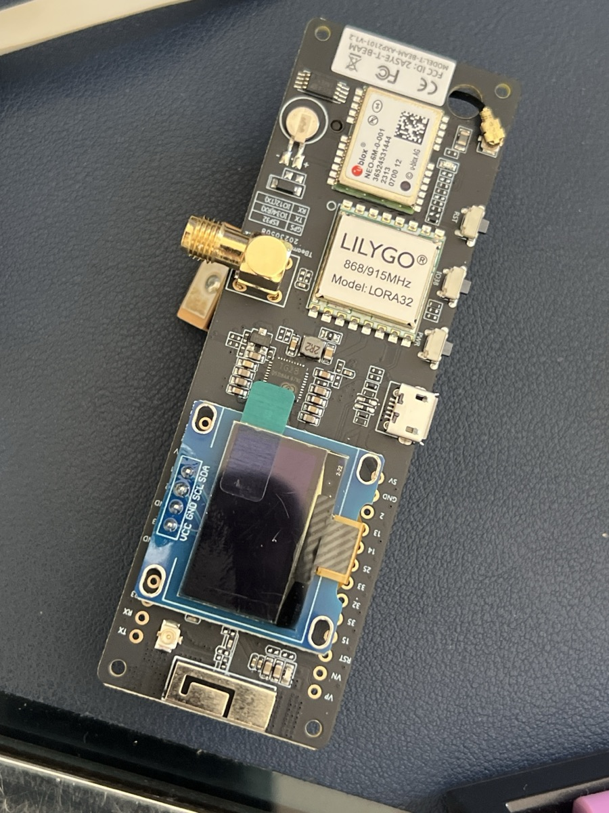
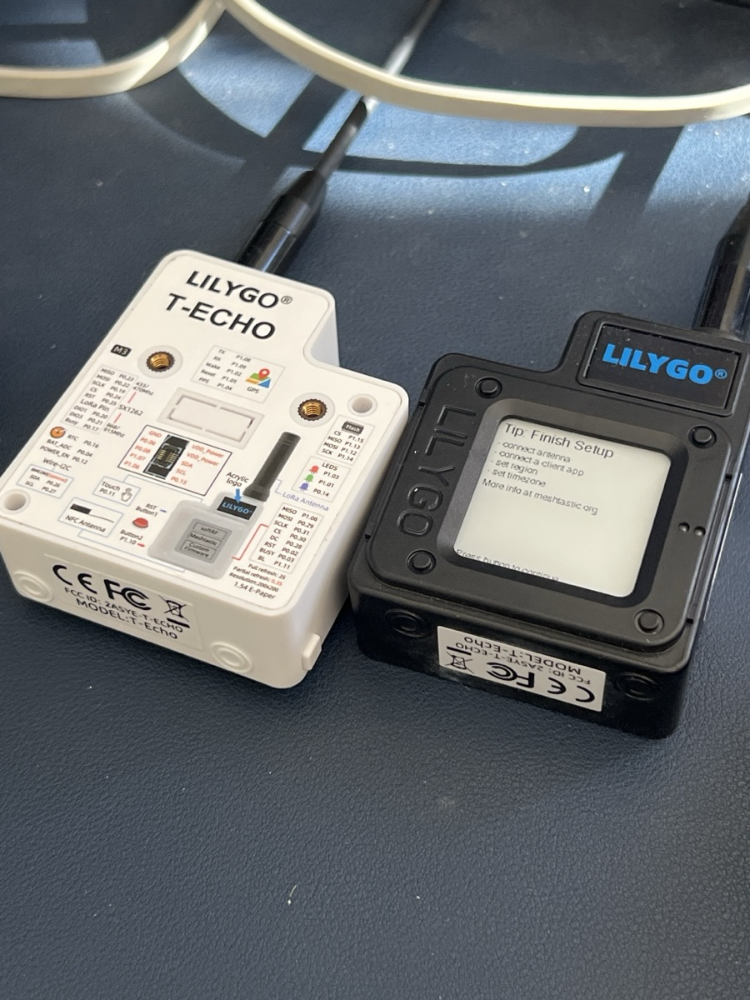
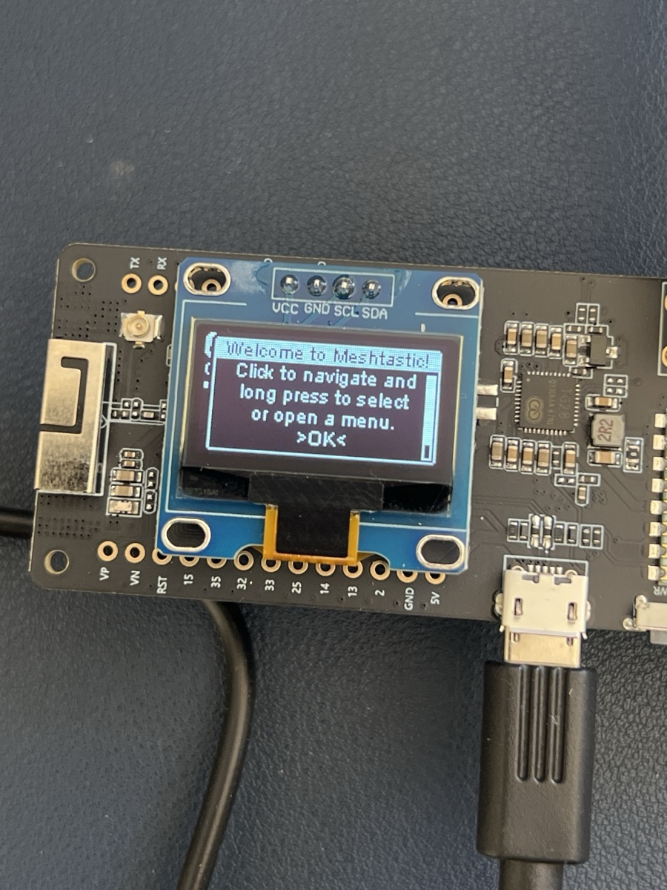
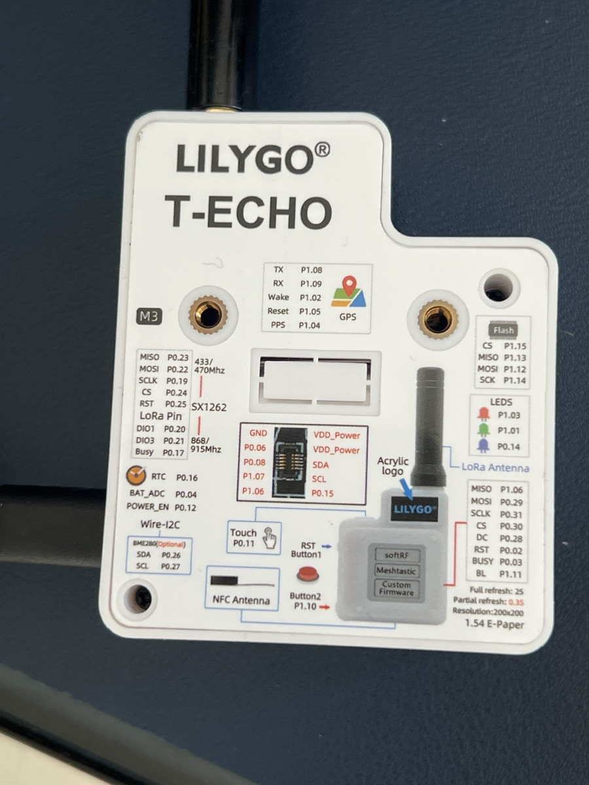
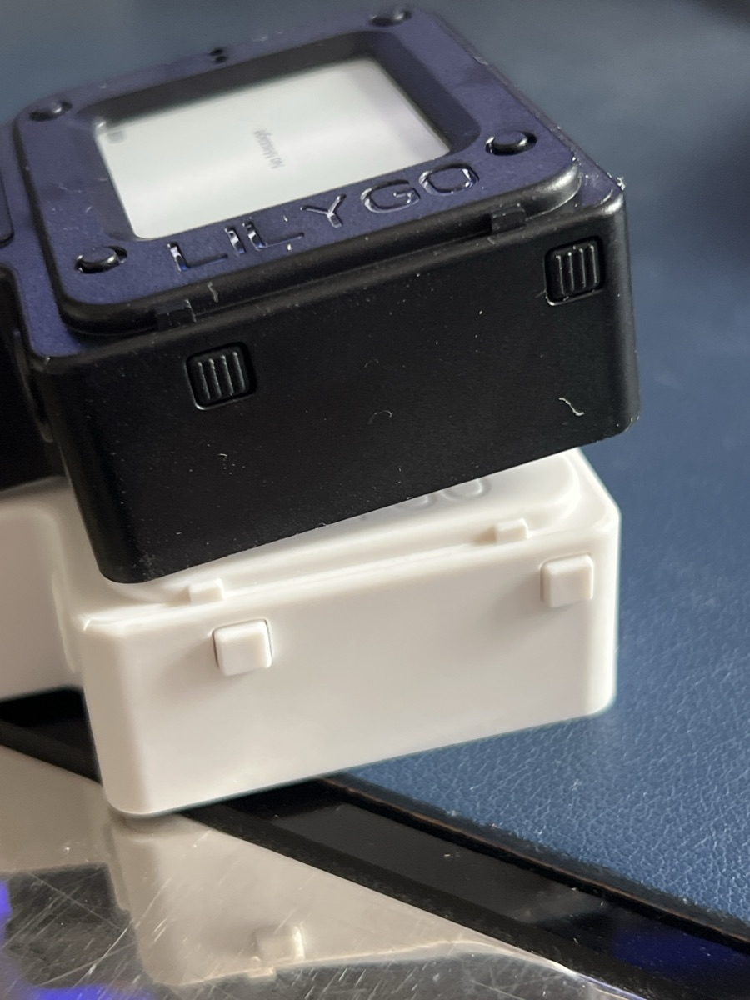
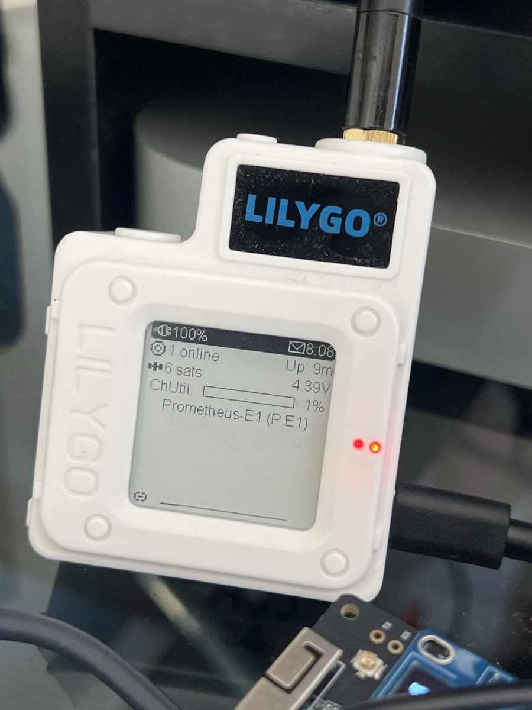
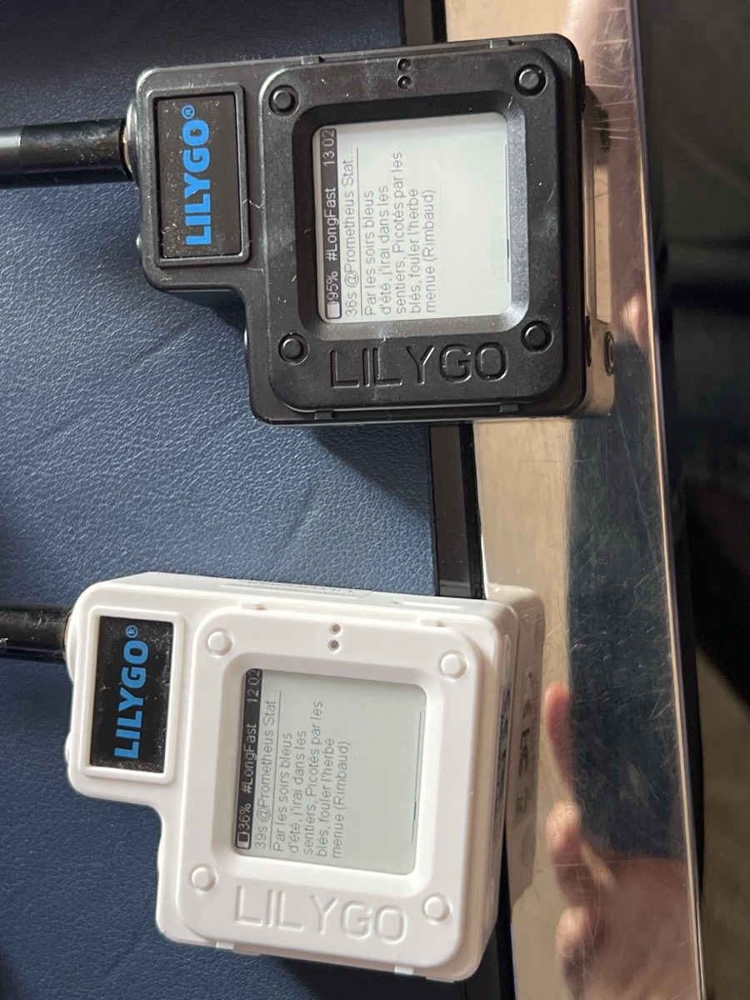
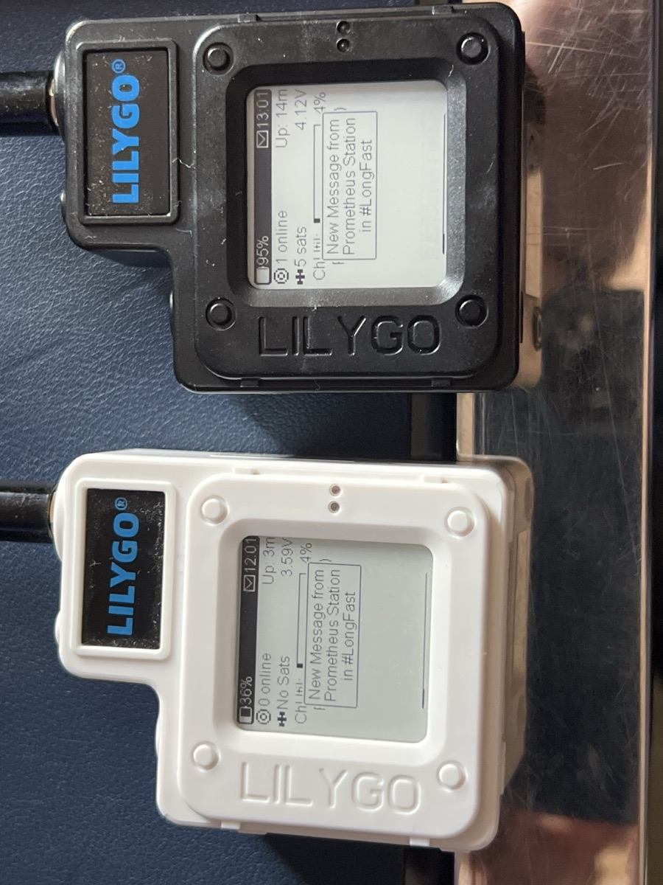
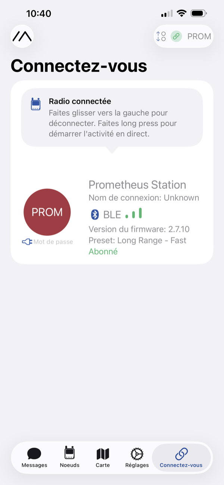
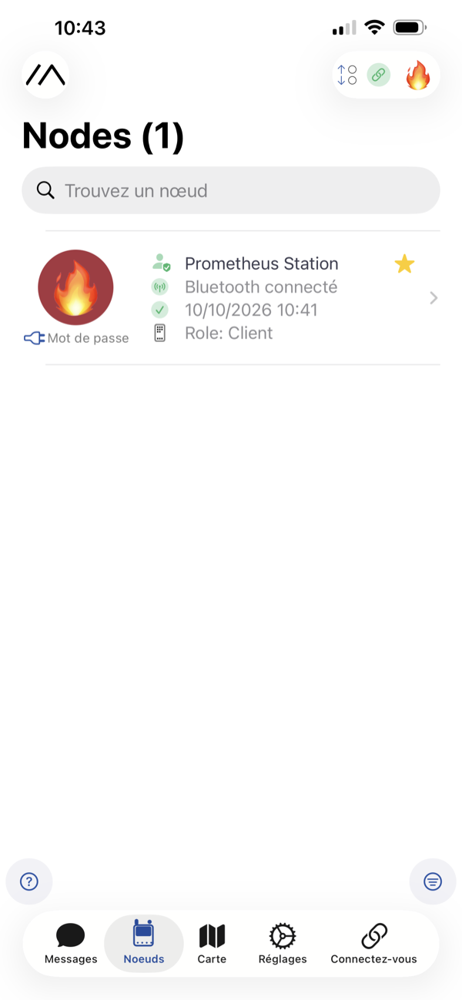

# 15. Meshtastic radios

*Phase 2.* This chapter gets the radios working: the **T-Beam** that plugs into the station, and the **T-Echo** handhelds that people carry. The [next chapter](16-radio-message-board.md) links them to the station's message board.

Script: [`installation/10-radio.sh`](../installation/10-radio.sh)

## What a Meshtastic radio does

A LoRa radio sends **short text messages** over long distances: from a few hundred metres indoors to several kilometres from a high point, with **no network at all**: no phone signal, no internet, no Wi-Fi. **Meshtastic** is the free software inside the radios. It turns them into a *mesh*: every radio that hears a message passes it on, up to 3 times, so messages can travel further than one radio could reach alone.

The radio carries **very little**: about 200 characters per message, a few messages per minute. Text only: no photos, no web pages.

## What you need

| Item | Role |
|---|---|
| **LILYGO T-Beam** 868 MHz (v1.2 here) | the station's radio, plugged into the Pi by USB |
| **LILYGO T-Echo** 868 MHz (two here) | the handhelds: e-ink screen, GPS, battery |
| 868 MHz antenna for each | supplied with the radios |
| an **18650 battery** for the T-Beam | keeps it running through power dips |
| **data** USB cables: micro-USB for the T-Beam, USB-C for the T-Echo | see the warning below |
| the free **Meshtastic** app (iPhone or Android) | to write messages from a phone through a T-Echo |

<p>


</p>

## ⚠️ Three rules before you start

1. **Screw the antenna on before any power.** A LoRa radio that transmits without its antenna can destroy itself, and Meshtastic transmits as soon as it starts. On the T-Beam, the LoRa antenna goes on the **gold right-angle socket**. The small square at the end of a thin wire is the **GPS** antenna: lay it flat side up.
2. **Use the right frequency band.** In Europe it is **868 MHz, region `EU_868`**. The US and Canada use 915 MHz. A radio with no region set refuses to transmit.
3. **Many USB cables only charge.** With such a cable, the radio lights up but the computer sees nothing. If a radio is not detected, change the cable first: it is the most common cause by far.

## Install the software on the station

On the Pi, from the `installation` folder (internet needed, for the Meshtastic library):

```
Pi$ cd ~/installation
Pi$ sudo bash 10-radio.sh
```

You should see, at the end:

```
== Radio installee (desactivee tant qu'elle n'est pas activee dans Parametres > Radio)
```

It installs the Meshtastic and MeshCore libraries, their command-line tools and `esptool` in `/opt/prometheus-radio`, the service `prometheus-radio`, which does nothing until you turn the radio on in the Settings ([next chapter](16-radio-message-board.md)), and the radio tool behind the Radio page ([chapter 17](17-radio-page.md)). With internet, it also fetches the latest stable software of both networks, kept on the station for later; just before the last line you should see `== Terminé` then `### FIN 0`.

In this guide, the tool is called like this:

```
Pi$ M=/opt/prometheus-radio/bin/meshtastic
```

> ⚠️ **Only one program can talk to a radio at a time.** Once the radio is turned on in the Settings, the station keeps the T-Beam's line open. Before using the tool on the T-Beam by hand, stop the service with `sudo systemctl stop prometheus-radio`, and start it again afterwards with `sudo systemctl start prometheus-radio`. The T-Echo are not concerned.

## The T-Beam (the station's radio)

### Plug it in

1. Antenna on (rule 1), a charged 18650 in its holder **underneath** the board (respect the **+** printed on the board).
2. Plug it into one of the Pi's **black** USB ports. The black ones are USB 2, the blue ones USB 3; USB 3 can disturb radio signals nearby, and the radio needs very little speed.
3. Check that the Pi sees it:

```
Pi$ ls /dev/serial/by-id/
usb-1a86_USB_Single_Serial_0123456789-if00
```

The name starts with `1a86` (the T-Beam's USB chip); the end differs for every board. **Note:** this name stays even when the T-Beam itself is switched off, because the USB chip is powered by the cable. Only an answer to `--info` (below) proves the radio is alive.



If its screen says **"Welcome to Meshtastic"**, the board already has Meshtastic: you only need to set it up.

### Its three buttons

They are in a row along the edge; their names are printed next to them, very small.

| Button | Where | Short press | Long press |
|---|---|---|---|
| **PWR** | nearest the micro-USB socket | turns the screen off | **switches the board on or off** |
| **IO38** | in the middle | **next page** on the screen, wakes the screen | about 0.5 s: menu of the page · about 4 s: switch off |
| **RST** | nearest the GPS | restarts the board | — |

The screen goes dark by itself after a while to save power: that is normal, press **IO38** to wake it.

### Read and set it up

The board is found by its name (copy yours from `ls /dev/serial/by-id/`):

```
Pi$ T=/dev/serial/by-id/usb-1a86_USB_Single_Serial_0123456789-if00
Pi$ $M --port $T --info | grep -E "^Owner|firmwareVersion|region"
```

You see its name, its Meshtastic version and its region. Then set it up, **one setting per command** (the radio restarts after each):

```
Pi$ $M --port $T --set lora.region EU_868
Pi$ $M --port $T --set-owner "Prometheus Station" --set-owner-short "🔥"
Pi$ $M --port $T --set device.tzdef "CET-1CEST,M3.5.0,M10.5.0/3"
```

- **The region** allows it to transmit (Europe).
- **The names**: the long one is shown in lists and next to messages; the short one in the small round badge. The short name is limited to **4 bytes**: four letters, or **a single emoji** (an emoji takes 4 bytes; `📡E1` would take 6 and be cut in the middle).
- **The time zone** (here, France): the radios take the time from GPS, in universal time; this tells them how to display it. It is kept for good. Other zones: see *Time zone* in the [Meshtastic settings](https://meshtastic.org/docs/configuration/radio/device/).

Check with `--info` again: `Owner: Prometheus Station (🔥)`, `region: EU_868`.

## The T-Echo (the handhelds)

### Plug it in to set it up

The T-Echo has its own battery: it only needs the cable to be set up, updated or charged. **Plug in one at a time**: see *Power* below.

```
Pi$ ls /dev/serial/by-id/
usb-LILYGO_TTGO_eink_0123456789ABCDEF-if00
```

Same setup as the T-Beam, with its own names, one setting per command:

```
Pi$ E=/dev/serial/by-id/usb-LILYGO_TTGO_eink_0123456789ABCDEF-if00
Pi$ $M --port $E --set lora.region EU_868
Pi$ $M --port $E --set-owner "Prometheus-E1"
Pi$ $M --port $E --set-owner-short "P.E1"
Pi$ $M --port $E --set device.tzdef "CET-1CEST,M3.5.0,M10.5.0/3"
```

> If a command answers `write failed: [Errno 5] Input/output error` or `Reconnect the USB cable`, the T-Echo was restarting after the previous setting. Wait 20 seconds and run the same command again.

On first start, the screen says **"Tip: Finish Setup"**: it is only a reminder (antenna, app, region, time zone).

### Its buttons

<p>


</p>

Hold the T-Echo **screen facing you, antenna at the top**. Two buttons on the side, and a touch area on top:

| Control | What it does |
|---|---|
| **The button at the top left = RESTART** (RST, *Button1* on the label) | one press: restarts (or switches on). **Two quick presses: "update mode"**, see below. In daily use, don't touch it |
| **The other button, at the bottom left of the screen = THE EVERYDAY BUTTON** (*Button2*) | short press: **next page**, wakes the screen · about 0.5 s: menu, or confirm · about 4 s then release: switch off (not in the first 30 seconds) |
| **The touch area on top** (*Touch*) | wakes the screen: **lay your finger flat** on it, a light touch is not enough |

A quick way to tell: if a press restarts the T-Echo, it was the restart button.

### What the screen says

<p>


</p>

| On the home page | Meaning |
|---|---|
| battery (%, and volts) | a plug icon means it is charging |
| **N online** | how many other radios it heard recently |
| **N sats** | GPS satellites in view (it knows where it is) |
| **ChUtil** | how busy the frequency is: a few % is fine |
| **Up** | time since it was switched on. If it often goes back to zero, the radio is restarting |
| the envelope ✉ | a message is waiting to be read |
| bottom line | its name |

When a message arrives, a band **"New Message from …"** appears, then the message fills the screen. **Patience**: e-ink takes a few seconds to redraw.



Good to know:
- **A T-Echo forgets its messages when it restarts.** "No Message" just after a restart is normal.
- Messages it **sent** itself appear on the right of its message list. Seeing them there only proves they left the T-Echo, not that anyone received them.

### Charging

With a cable that has a **classic (USB-A) plug on one side**. LILYGO warns that a USB-C to USB-C cable may not power it at all. Red light on: charging; off: full; blinking: battery missing or faulty.

## The phone app (optional)

The free **Meshtastic** app (iPhone, Android) connects to **one** radio by Bluetooth and becomes its keyboard and screen. The phone itself never transmits: it hands the message to the radio, which sends it.

<p>


</p>

1. Open the app, **Connect** tab, choose the radio in the list.
2. Type the **6-digit code** shown on the radio's screen.
3. **Messages** tab, main channel (*LongFast*): write as in a text message. **Nodes** tab: the radios heard.

*The app follows the phone's language: these screenshots are partly in French.*

## Updating Meshtastic

> **The simple way, since October 2026:** the **Radio page** fetches the latest versions and updates the T-Beam, or a T-Echo plugged into the station, in one tap, keeping their settings ([chapter 17](17-radio-page.md#radio-software)). Below is the same thing by hand, to understand it or to repair.

All radios should run **the same version**: between versions, the screens and some behaviour change. Take the **latest stable version** from the [Meshtastic releases](https://github.com/meshtastic/firmware/releases) (the ones not marked *Pre-release*). Here, all three radios run **2.7.26**. Updating keeps the settings (names, region, time zone).

Download the two packages on the Pi, then take out the files you need:

```
Pi$ mkdir -p ~/firmware && cd ~/firmware
Pi$ V=2.7.26.54e0d8d
Pi$ curl -LO https://github.com/meshtastic/firmware/releases/download/v$V/firmware-nrf52840-$V.zip
Pi$ curl -LO https://github.com/meshtastic/firmware/releases/download/v$V/firmware-esp32-$V.zip
Pi$ unzip -o firmware-nrf52840-$V.zip firmware-t-echo-$V.uf2
Pi$ unzip -o firmware-esp32-$V.zip firmware-tbeam-$V.bin
```

### A T-Echo: no button needed

```
Pi$ $M --port $E --enter-dfu
Pi$ lsblk -no LABEL /dev/sda
TECHOBOOT
Pi$ sudo mkdir -p /mnt/techoboot
Pi$ sudo mount /dev/sda /mnt/techoboot
Pi$ sudo cp ~/firmware/firmware-t-echo-$V.uf2 /mnt/techoboot/ && sync
Pi$ sudo umount /mnt/techoboot
```

`--enter-dfu` puts the T-Echo in **update mode**: its screen freezes and the Pi sees it as a small USB drive named `TECHOBOOT`. Copying the file installs it; the T-Echo restarts by itself in the new version (the `umount` may answer that the drive is already gone: that is fine). Wait 30 seconds and check with `--info`.

> **A T-Echo stuck in update mode** (frozen screen, `TECHOBOOT` drive): one press on its restart button gets it out, or copy the `.uf2` file again as above.

### The T-Beam

```
Pi$ sudo systemctl stop prometheus-radio
Pi$ sudo /opt/prometheus-radio/bin/pip install esptool
Pi$ sudo /opt/prometheus-radio/bin/esptool --port $T --baud 115200 write-flash 0x10000 ~/firmware/firmware-tbeam-$V.bin
Pi$ sudo systemctl start prometheus-radio
```

It takes about two minutes and ends with `Hash of data verified.` then `Hard resetting via RTS pin...`. Don't touch anything meanwhile.

> ⚠️ Never use the file ending in **`.factory.bin`** for an update: it erases everything.

## Power

Learned the hard way, all on the same day:

- **A computer's USB port is not enough** for the Pi plus radios: the Pi warns of low voltage, the T-Beam switches off, a T-Echo restarts in a loop. Give the Pi its own **5 V 3 A** power supply (or the power bank directly).
- **The T-Beam always with its 18650**: it absorbs the power peaks when it transmits.
- **One T-Echo at a time** on the Pi, and only to set it up: plugged in, it also charges its battery, which draws current.
- **Never plug or unplug the power bank's own charger while it powers the station**: many power banks cut their outputs for a moment when they switch, and the Pi goes off at once.
- *Settings > Station health* tells whether the power has been too low.

Next: [16. Radio and message board →](16-radio-message-board.md)
