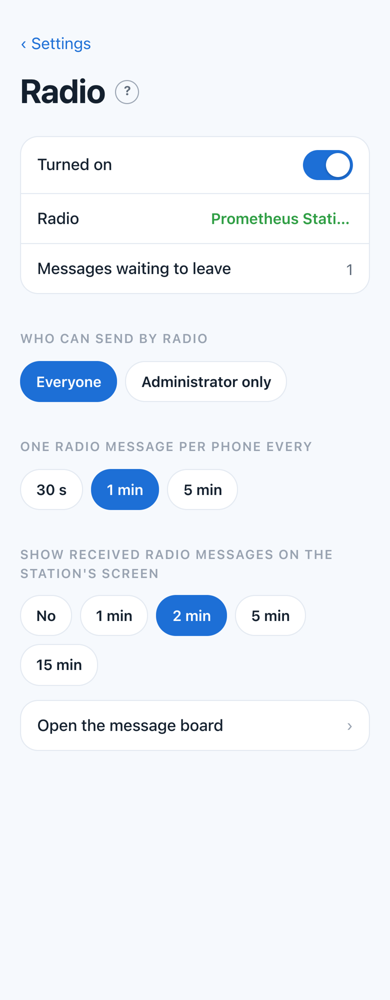
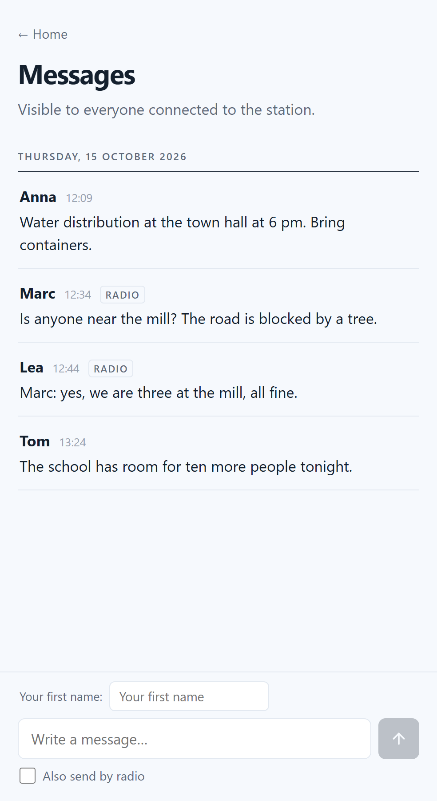
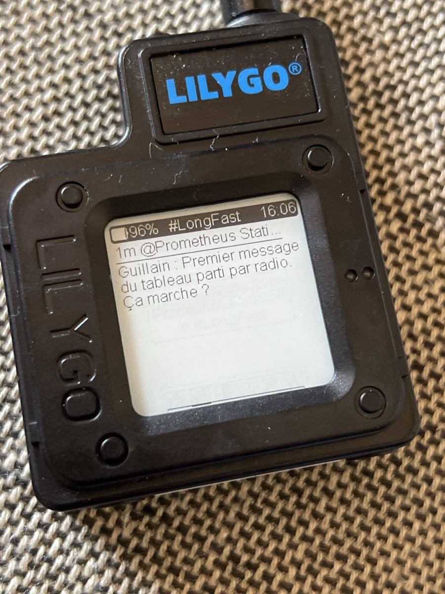
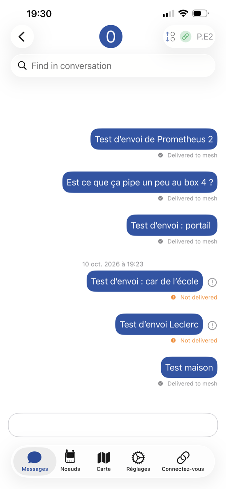
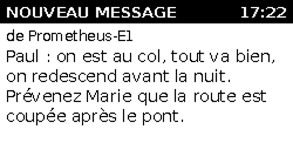

# 16. Radio and message board

*Phase 2.* With the T-Beam plugged in ([chapter 15](15-meshtastic-radios.md)), the station's **message board** goes on the air:

- someone **without a radio** writes on the board from their phone, ticks *Also send by radio*, and the message reaches every radio in range;
- what the radios send **appears on the board**, with the radio's name.

```
phone ──Wi-Fi──> Messages page ──> Pi ──USB──> T-Beam ──radio──> T-Echo (kilometres away)
phone <──Wi-Fi── Messages page <── Pi <──USB── T-Beam <──radio── T-Echo
```

Both directions were tested for real: board → T-Echo, and T-Echo (written from an iPhone) → board.

## Turn it on

**Settings › Station › Radio**, switch **Turned on**. Within half a minute, the *Radio* line shows the radio's name in green.



| Setting | Choices | Default |
|---|---|---|
| **Turned on** | — | **off** |
| **Radio** | the radio's name when all is well · *Not plugged in* · *Not responding* | — |
| **Messages waiting to leave** | how many are queued | — |
| **Who can send by radio** | Everyone · Administrator only | Everyone |
| **One radio message per phone every** | 30 s · 1 min · 5 min | 1 min |
| **Show received radio messages on the station's screen** | No · 1, 2, 5 or 15 min | No |

The **?** next to the title explains it in two sentences, as everywhere in the Settings.

## Sending from the board

<p>


</p>

- Under the text field, tick **Also send by radio**. The phone remembers the choice. The box only appears when the radio is turned on, and allowed for this phone.
- The counter on the right shows the room left. A radio message holds **228 bytes** on Meshtastic (**about 140** on MeshCore, see [chapter 17](17-radio-page.md)), and the writer's name is sent in front of the text (*Marc : Is anyone near the mill?*), otherwise every message would seem to come from the station. An accented letter takes 2 bytes, so it counts double.
- Next to the name: **RADIO · WAITING** while it is queued, then **RADIO** once it has left. The station sends at most **one message every 15 seconds**, to respect the airtime limits of the 868 MHz band.
- If the radio is unplugged or silent, a line says so; the message leaves as soon as the radio is back.

On the T-Echo, the message arrives from *Prometheus Station*, with the writer's name in front (right-hand photo).

## Receiving on the board

A message sent by a T-Echo, or by a phone connected to one, appears on the board **under the radio's name**, marked **RADIO** next to the time. The board refreshes itself every 15 seconds. To know who wrote, people type their name in the message.

From the phone app ([chapter 15](15-meshtastic-radios.md)), send on the **main channel** (*LongFast*). A message sent directly to the station's radio arrives on the board too.

### "Delivered to mesh" or "Not delivered"



In the app, under each message:

- **Delivered to mesh**: another radio heard it and passed it on.
- **Not delivered**: no radio heard it, after several tries. **The message is lost**: Meshtastic does not keep it to send later. It happens when the station is switched off, or out of range.

In the screenshot, the messages marked *Not delivered* were sent while the station was switched off. Those sent before and after it was switched off were delivered.

## On the station's e-ink screen



With *Show received radio messages on the station's screen* set to a duration, a message arriving by radio replaces the QR code: a black band **NOUVEAU MESSAGE** (*new message*) with the time, **de** (*from*) the radio's name, then the text as large as it fits (20, 18 or 16 points). A message too long for the screen **scrolls**: one line every 3 seconds, a 5-second pause at the bottom, then back to the top, without the black-and-white flash of a full refresh. After the chosen duration, the screen goes back to normal by itself. Only messages **received by radio** are shown, not those written on the board.

## Deleting messages

Deleting a message on the board, or *Delete all messages*, **does not delete it from the radios**: each radio keeps its own copy, like a text message already sent. A T-Echo forgets its messages when it restarts.

What deleting does: a message **not yet sent** by radio is taken out of the queue and will never leave. Before you confirm, the Settings warn you: *Warning: 2 message(s) not yet sent by radio will not be sent. Those already sent by radio stay on the radios.* The same goes for *Erase what visitors wrote*.

## The beacon

**Settings › Radio › Beacon.** Every few hours the station sends a ready-made message by radio, on its own, so that people who have a radio but don't know the station learn that it exists, where it is, and how to join it. Off at first.

- **Message**: write it yourself; the buttons insert fields the station fills in when sending: `{nom}` (the radio's name), `{position}` (its fixed position, set in the Mesh section › Settings; empty without one), `{wifi}` (the station's Wi-Fi name), `{heure}` (the time), `{batterie}` (the radio's battery). At first, in French: `{nom} : station de savoir hors ligne et messages. Wifi ouvert « {wifi} ». {position}` (*offline knowledge station and messages, open Wi-Fi…*). Under it, the station shows **exactly what will be sent** and its size (228 bytes on Meshtastic, about 140 on MeshCore; a longer text is cut at the end).
- **Sent every** 1, 3 (at first), 6 or 12 hours, **on the channel** you choose.
- **Only when the Emergency page is on** (ticked at first): the beacon only runs during a crisis and stops by itself when the Emergency page is turned off. In ordinary times an automatic message on the public channel is unwelcome: on MeshCore every repeater passes it across the whole area.
- It joins the same queue as the board's messages (same spacing, same radio journal). One short message every 3 hours is about a second or two on the air, far below the European limit.

**Its position becomes public**: radios that relay what they hear to the internet (« MQTT observers ») can put it on online maps. Give a landmark (*near the town hall*) rather than your home's exact address.

> Tested: off, or on with the Emergency page off, nothing leaves; on without the emergency condition, one message left on MeshCore's *Public* channel, and no second one a minute later; with the Emergency page on (checked on test settings, so as not to show the Emergency page to visitors), it leaves at once, then waits 3 hours; a text too long for the network is cut to its size.

## Low-power mode

The low-power mode (*Settings › Energy*) normally switches the USB ports off. **When the radio is turned on, it leaves them on**, so the T-Beam keeps working.

## How it works inside

| Part | Role |
|---|---|
| `prometheus-radio` (Python, Meshtastic and MeshCore libraries in `/opt/prometheus-radio`) | keeps the line to the T-Beam open (USB on Meshtastic, Bluetooth on MeshCore); sends the queued messages; files the received ones; reports the radio's state. Does nothing while the radio is turned off |
| `prometheus-admin` | the board itself; puts radio messages in the queue, checks the limits, files what came in |
| `/srv/prometheus/radio/` | `a-envoyer/` (queue), `partis/` (sent), `recus/` (received), `etat.json` (`eteinte` off · `absente` not plugged in · `muette` not responding · `ok`; plus the network and the byte limit); for the Radio page: `details.json`, `journal.json` ([chapter 17](17-radio-page.md)) |

The two programs only exchange files: if the radio program stops, the board keeps working. Without news from the radio for 10 minutes, `prometheus-radio` reopens the line, which proves the radio still answers; otherwise it reports it as *Not responding*.

## Troubleshooting

| Problem | Check |
|---|---|
| *Not plugged in* | `ls /dev/serial/by-id/` shows nothing starting with `1a86`: cable not pushed in, or a charge-only cable |
| *Not responding* | the board is off (screen dark and IO38 doesn't wake it): press **PWR** for one second; check its 18650 |
| The box *Also send by radio* is missing | radio turned off, or *Who can send* is set to *Administrator only* and you are not signed in |
| *One radio message at a time: try again in a moment.* | the per-phone delay (Settings) |
| *Too long for the radio.* | shorten the message (accents count double) |
| A T-Echo's messages don't arrive | is the station on? In range? Antenna screwed on? The app says *Not delivered* when nobody heard it |
| The tool `meshtastic` can't open the T-Beam | the station is holding it: `sudo systemctl stop prometheus-radio` first |
| What the radio program says | `sudo journalctl -u prometheus-radio -n 20` |

## Not tested yet

- **Range.** All tests so far were indoors, the T-Beam on a desk. A walk with a T-Echo, then the antenna on the mast, will tell how far it reaches.
- Several T-Echo writing at the same time; another Meshtastic user nearby on the same channel.

Next: [17. The Radio page →](17-radio-page.md)
