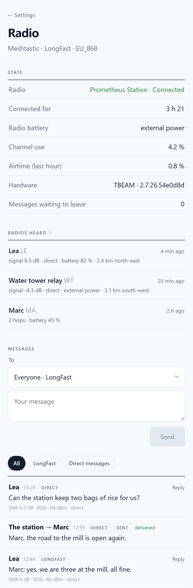
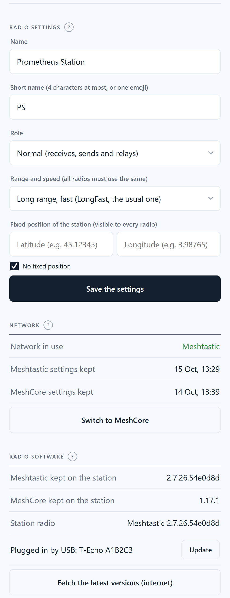

# 17. The Radio page — two networks, one radio

*Phase 2.* The message board ([chapter 16](16-radio-message-board.md)) is the simple door to the radio, for everyone. The **Radio page** is the station's radio set, for the keeper only: what the radio hears, every channel, direct messages, its settings, the choice between the two big LoRa networks, **Meshtastic** and **MeshCore**, and the radios' software.

Open it from **Settings › Station › Radio › Open the radio page**. It is protected by the station's password, like the Settings.

*(Screenshots with made-up names and places.)*

## Why two networks

When the internet is gone, nobody knows which radio network the neighbours will be using. Meshtastic and MeshCore are the two widespread free ones; they work in the same band but **cannot hear each other**. The station keeps the software of both and switches its T-Beam from one to the other **in one tap**, keeping the settings of each network apart. A radio is on one network at a time: that is a choice, not a missing feature (no second radio to buy, power and plug).

## State

The radio's name and whether it answers, how long it has been connected, its battery, how busy the channel is and how much of the allowed airtime the station used in the last hour (red above 8 %), its hardware and software version, and the messages waiting to leave. The line under the title gives the network and its settings (*Meshtastic · LongFast · EU_868*, or *MeshCore · 869.618 MHz*).

## Radios heard

Every radio the station knows, most recent first: its name, when it was last heard, the signal strength when heard directly, **direct** or **2 hops** (passed on by other radios), its battery, and, when both the station and that radio share a position, **how far and in which direction** (*2.4 km north-east*). Radios not heard for a day are greyed out. Right after the radio restarts, the list says *not heard since restart* until each radio speaks again.

## Messages

All radio messages, received and sent, **every channel**, not only those that reach the board. Filter by channel or **Direct messages**. Under each received message: its signal (SNR, RSSI) and how many hops it took.

**Writing**, at the top of the section:

- **To**: *Everyone* on a channel, or **one radio** (a direct message). **Reply**, next to a received message, picks its sender.
- The counter shows the room left: **228 bytes** on Meshtastic; on MeshCore **160**, minus the station's name, which MeshCore puts in front of channel messages (about **140**).
- The message joins the same queue as the board (one every 15 seconds at most).
- A **direct message** waits for an acknowledgement from the other radio: **delivered** when it answered, **not delivered** when the station gave up after several tries. Not delivered means lost: neither network keeps it to send later.

> Tested: a T-Echo on its own battery acknowledges at once (*delivered*). A T-Echo **plugged into a computer by USB with no app connected** did not acknowledge the station's direct messages, while it acknowledged as soon as a program was connected to it. It is the T-Echo's behaviour, not the station's (the official Meshtastic tool behaved the same way).

## Radio settings

Prefilled with the radio's current settings; only what you change is sent. **The radio's settings are saved first**, so you can always go back.

| Setting | Meshtastic | MeshCore |
|---|---|---|
| **Name** | long name (36 characters) | name |
| **Short name** | 4 bytes: four letters, or one emoji | — |
| **Role** | *Normal* (receives, sends, relays) · *Quiet* (does not relay others) · *Relay* (always relays first: for a radio high up) · *Back-up relay* (relays when nobody else did) | — |
| **Range and speed** | *LongFast* (the usual one) and the other presets. **Every radio must use the same one**, or they stop hearing each other | — (set by the network switch, see below) |
| **Fixed position** | latitude and longitude, or *No fixed position* | the same |

The fixed position is **broadcast to every radio in range**, and from there it can end up on public maps: think before giving your home's. A T-Beam with GPS already sends its own position when it has a fix.

Changing the role or the range restarts the radio: allow half a minute.

## Network: switching between Meshtastic and MeshCore

**Network in use**, the dates of the last settings kept for each network, and one button: **Switch to MeshCore** (or *to Meshtastic*). Tap, then tap again to confirm. The radio is off the air for one to three minutes. What happens, step by step, scrolls in the window at the bottom of the page.

**Meshtastic → MeshCore**

1. The radio service stops; the Meshtastic settings are saved (name, channels, settings, and the radio's **identity**, its private key).
2. The radio is erased and MeshCore is written in.
3. The MeshCore memory kept from last time is put back (identity, contacts, channels, name, radio settings). The very first time there is none: the station applies the recommended European setting (**869.618 MHz, 62.5 kHz, SF8, CR8**) and gives the radio the station's name.
4. The station pairs with the radio over **Bluetooth** (see below) and the radio announces itself on the network.

**MeshCore → Meshtastic**

1. The MeshCore settings are saved, and the radio's whole MeshCore memory (128 KB) is copied.
2. The radio is erased and Meshtastic is written in.
3. The saved settings are put back, then the identity, and the station **checks that the radio has its old identity back**: for the other radios, it is the same station. If not, it says so.

**If anything goes wrong on the way to MeshCore, the station goes back to Meshtastic by itself**, with its settings and identity: it is never left without a radio. This was seen for real during the tests.

### The code on the radio's screen, the first time only

On a T-Beam, MeshCore talks to the station over **Bluetooth** only: it offers no USB version for this board. And on a radio **with a screen**, MeshCore picks a **random 6-digit code** at every start and shows it on the screen. So, the very first time you switch to MeshCore:

- the window says **CODE À TAPER** (*code to type*) and a field appears above it, *Code shown on the screen of the station's radio*: **type the code shown on the T-Beam's screen** (you have 10 minutes; after that, the station goes back to Meshtastic);
- the station then sets the radio's code to a fixed one and keeps it in the MeshCore memory it saves. **From then on, every switch is done without anyone**: tested twice in a row.

### Bluetooth

The station's Bluetooth is **off and blocked** while the radio is on Meshtastic (it is not needed, and it saves a little power). It is turned on only while the radio is on MeshCore, and after a restart if the station was left on MeshCore.

## Radio software

| Line | Meaning |
|---|---|
| **Meshtastic / MeshCore kept on the station** | the versions stored on the station, to switch networks and update the radios **without internet** (the last two of each are kept) |
| **Station radio** | the network and version in the T-Beam |
| **T-Echo plugged in by USB** | each T-Echo plugged into the station: its name, what it runs and which version, and what can be done with it (below) |

- **Fetch the latest versions (internet)**: downloads the latest stable Meshtastic (not the *alpha* versions) and the latest MeshCore *companion*, only the files the station's radios need, and checks each file's SHA-256 fingerprint against the one published.
- **Every day, by itself**: when the station has internet, it fetches new versions on its own (a timer, `prometheus-radio-chercher`, about 20 minutes after start-up, then daily). It **never installs them in a radio by itself**: a radio is off the air while it is updated, so you choose the moment. When a newer version than the station radio's is kept, *Settings › Radio* says **Update available**.
- **Update the station radio** appears when a newer version than the radio's is kept: it writes only the program part of the T-Beam, so **its settings and identity stay** (saved first anyway).

### The T-Echo: Meshtastic, MeshCore for a phone, or MeshCore for the station

Plug a T-Echo into the station: the page recognises it by itself (*being identified…*, then its name, software and version). Then choose, and **Start**:

| Choice | What it gives |
|---|---|
| **Update** | the latest kept version of what it already runs; settings and identity kept |
| **Switch to Meshtastic (full screen)** | the handheld Meshtastic radio of chapter 15 |
| **Switch to Meshtastic InkHUD (simple screen)** | the same Meshtastic radio, same settings and identity, with **InkHUD**, Meshtastic's simpler official interface for e-ink screens. The station remembers which interface each T-Echo has, and an update keeps it |
| **Switch to MeshCore (phone)** | a MeshCore radio used with the MeshCore phone app, over Bluetooth: the usual handheld |
| **Switch to MeshCore (station)** | a MeshCore radio driven through the USB cable, by the station (or a computer): for when there is no phone, but a keyboard and a screen on the station |

What the station keeps for each T-Echo, by its serial number: its **Meshtastic settings** (identity included, put back and checked when it returns to Meshtastic) and its **MeshCore identity and settings**. To go to MeshCore, it always passes through the *station* version first: that is the one it can set through the cable (the European setting 869.618 MHz / 62.5 kHz / SF8 / CR8, the radio's name, its saved MeshCore identity); the *phone* version then keeps them as they are.

**When your hand is needed.** MeshCore offers no command to put a T-Echo back in update mode, so **leaving MeshCore** (to Meshtastic, or between its two versions, or to update it) asks you, in a line above the window: **press the T-Echo's reset button twice quickly** (top left). Its two front lights turn red and its screen freezes: that is update mode. You can also do it before tapping *Start*. After a return to Meshtastic, the T-Echo sometimes stays silent: the page then asks for **one press** on reset. From Meshtastic, nothing is needed.

If the T-Echo's update drive does not appear, the station installs through its serial port instead (`adafruit-nrfutil`, with the `.zip` package it keeps for that).

Tested on a T-Echo, one way after the other: Meshtastic → MeshCore (station) with the European setting, → MeshCore (phone) (the T-Echo then announces itself in Bluetooth under its name), → Meshtastic with its **identity checked**, then an update with its identity unchanged.

## The window at the bottom

Every operation of this page (settings, network switch, software) writes what it does, line by line, into a window that scrolls while it runs, then a line says **Done** or **Failed**, with the details kept above. *Show the details of the last operation* brings them back later. Keys and passwords never appear in it: they are masked. The details are written in French, like the station's other internal messages; the tool's own output (`esptool`, `meshtastic`) is in English.

## How it works inside

| Part | Role |
|---|---|
| `prometheus-radio` | the radio service: one part for Meshtastic (USB), one for MeshCore (Bluetooth), behind the same exchange files. It reads which network is in use in `reseau.json` |
| `prometheus-radio-outil` | the radio tool, run as administrator: `sauvegarder` (save), `regler` (settings), `reseau` (switch), `chercher` (fetch), `installer` (update), `t-echo` (a plugged T-Echo: update or switch), `detecter` (recognise the plugged T-Echo). One at a time, in its own service, so closing the page doesn't stop it |
| `prometheus-radio-chercher` (timer) | runs `prometheus-radio-outil chercher-auto` daily: fetch only, with its own details file `radio-chercher.txt`, nothing without internet |
| `prometheus-commande` | the page drops an order (`radio-…`) in a folder; this service starts the tool. No page ever runs a program itself |
| `prometheus-admin` | the Radio page's data (`GET /radio`), sending (`/radio/envoyer`), the screen code (`/radio/code`) |

| Path | Content |
|---|---|
| `/srv/prometheus/radio/reseau.json` | network in use, radio chip (SX1276 or SX1262), Bluetooth address |
| `/srv/prometheus/radio/details.json`, `journal.json` | the radio up close (rewritten every 30 s) and the last 300 radio messages; *Erase what visitors wrote* empties the journal too |
| `/srv/prometheus/radio/logiciels/` | the radio software kept on the station: T-Beam (Meshtastic, MeshCore), T-Echo (Meshtastic, MeshCore *phone* and *station*), as `.uf2` and as `.zip` for the serial port |
| `/srv/prometheus/radio/radios.json` | what the station knows of each T-Echo it has seen, by serial number |
| `/srv/prometheus/radio/sauvegardes/` | the settings of each network and the MeshCore memory. They contain the radios' **private keys**: readable by the administrator account only |
| `/var/www/prometheus/ajouter/radio-outil.txt` | the details of the last operation (behind the password) |

Installed by `10-radio.sh` ([chapter 15](15-meshtastic-radios.md)), which also fetches the radio software when internet is there. The chip is read from the radio's start-up messages (*RF95* means SX1276), which picks the right MeshCore file.

## Tested, and not

**Tested for real:** the page with two T-Echo heard; sending on a channel; a direct message delivered to a T-Echo on battery, and a T-Echo's direct message received with its acknowledgement; name, short name, role and range changed and put back; fetching both networks' software with their fingerprints; updating the T-Beam and a T-Echo with settings and identity unchanged; **two full round trips Meshtastic → MeshCore → Meshtastic**, the second without anyone, the MeshCore identity identical on return and the Meshtastic identity checked each time; the automatic return to Meshtastic when MeshCore failed.

**On MeshCore, with a T-Echo put on MeshCore for the test, one metre away:** messages on *Public* both ways, each radio adding the other to its contacts from its announcement, and direct messages from the station **delivered**. A direct message only gets through once the other radio has heard the station's announcement (it needs the station's key); before that, it comes back *not delivered*.

**T-Echo:** Meshtastic → MeshCore (station) → MeshCore (phone) → Meshtastic with its identity checked, and an update, on the same T-Echo; InkHUD installed on the other T-Echo, its settings kept; the T-Beam switched to MeshCore 1.18.0 and back, its MeshCore identity kept from 1.17.1.

**Not tested:** setting a fixed position (it would have broadcast one); range outdoors.

## Troubleshooting

| Problem | Check |
|---|---|
| *Switch to MeshCore* is greyed out | no MeshCore software kept: **Fetch the latest versions** with internet first |
| The switch stopped at *CODE À TAPER* | read the 6 digits on the T-Beam's screen and type them in the field; without a code within 10 minutes, the station goes back to Meshtastic |
| *The operation did not start* | another radio operation is running: wait for it, then try again |
| A direct message is *not delivered* | is the other radio on and in range? A T-Echo plugged into a computer without an app may not answer (see *Messages*). On MeshCore, the other radio must first have heard the station's announcement: the station announces itself when it connects and every 6 hours |
| On MeshCore, nothing is ever received | same radio settings on both sides (frequency, bandwidth, SF, CR)? Then it is range: the station's short antenna indoors did not reach a repeater 1.4 km away during the tests; put it by a window, outdoors or on the mast |
| The T-Echo doesn't appear under *T-Echo plugged in by USB* | a charge-only cable: `dmesg` shows *device descriptor read/64, error -32*; or the cable moved when you pressed reset: unplug it and plug it again |
| A T-Echo is refused by the station (`dmesg`: *device not accepting address, error -71*, *unable to enumerate USB device*) | try **another USB port** of the Pi: during the tests one port kept refusing a T-Echo that another port took at once |
| The page waits for *press reset twice* and nothing happens | press faster; its two front lights turn **red** in update mode. Unplug and plug the cable again if the station does not see it |
| What the radio tool did | the window at the bottom of the page, or `sudo journalctl -u prometheus-radio-outil -n 50` |

Next: what comes after is in the [Reference](REFERENCE.md#status-october-2026).
