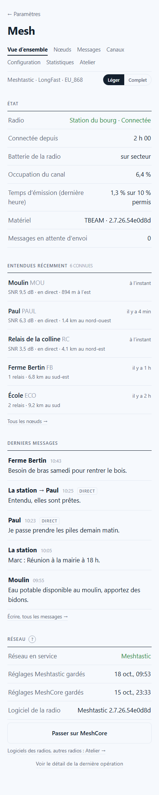
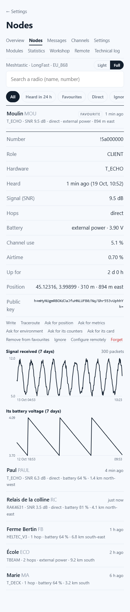
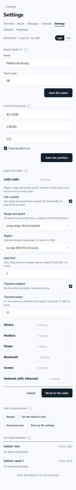
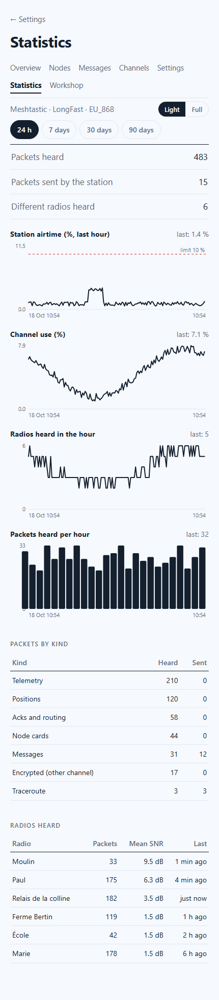
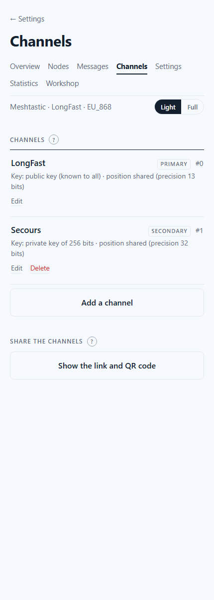
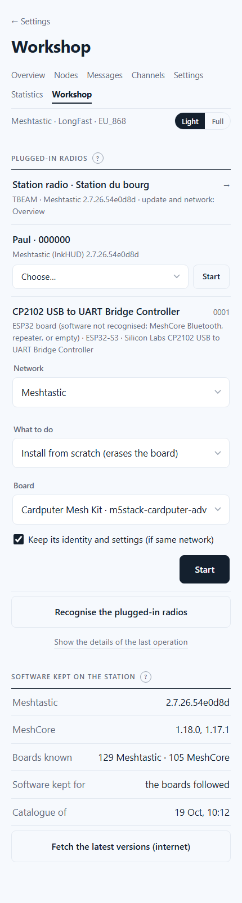

# 18. The Mesh section — a complete Meshtastic and MeshCore station

*Phase 2.* Sending messages is not enough on the day the internet is gone: someone has to look after the network itself. The **Mesh section** turns the station into a full mesh-radio post: every radio it knows and what you can ask each one, every channel and its key, **every setting** of the radio, its modules, statistics kept for 90 days, the radios of other people configured over the air, and a workshop that installs Meshtastic or MeshCore on **any supported board** plugged into the station, without internet.

It replaces the Radio page of [chapter 17](17-radio-page.md), which became its **Overview**: nothing was lost, and chapter 17 still describes the network switch and the T-Echo operations in detail.

Open it from **Settings › Station › Radio › Open the Mesh section**. It is protected by the station's password.

*(Screenshots with made-up names, places and keys.)*

## Light and Full

Every page has a **Light / Full** switch at the top. **Light** shows what you need day to day. **Full** shows everything, even what is used once a year: every single setting, technical names, keys, raw counters, and three more pages (**Modules**, **Remote**, **Technical log**). Each phone remembers its choice.

## The pages

| Page | Light | Full adds |
|---|---|---|
| **Overview** | the radio's state, the radios heard recently, the latest messages, the network in use (switch Meshtastic ⇄ MeshCore), the station radio's update | the radio's number, more radios |
| **Nodes** | every radio the station knows: name, when heard, signal, hops, battery, distance and direction. Tap one for its **card** | its role, hardware, public key, channel use, uptime, battery history; *Ignore*, *Forget*, *Configure remotely* |
| **Messages** | write to a channel or to one radio, every channel, *Reply* | search every text heard or sent over the kept history |
| **Channels** | the channels, their key kind, adding, editing, deleting; the share link and its **QR code** | uplink/downlink to the internet, the key itself, importing a channel link |
| **Settings** | name, position, the essential settings of each section | **every** setting of every section, with its technical name |
| **Modules** *(Full)* | — | the Meshtastic modules: telemetry, store & forward, range test, neighbour info, canned messages, alerts, detection sensor, MQTT, serial, remote hardware, audio, ambient lighting, people counter, status message, traffic management, TAK |
| **Statistics** | airtime against the **10 % European limit**, channel use, radios heard per hour, packets per hour, packets by kind, radios heard | noise floor, the radio's battery, its raw counters |
| **Workshop** | every radio plugged into the station: recognised, then updated or installed | the boards followed (software kept without internet) |
| **Remote** *(Full)* | — | configure another Meshtastic radio over the air; log in to a MeshCore repeater or room server and send it commands |
| **Technical log** *(Full)* | — | every packet heard or sent, live, decoded; export as JSON |

## Nodes: what you can ask a radio

**Meshtastic.** *Traceroute* (the path out and back, with the signal at each hop), *Ask for position*, *Ask for metrics* (battery, channel use), *Ask for environment* or *its counters*, *Ask for its card*. Answers come back by radio within a minute or two and appear under the card; *No answer* says why (*the radio has nothing to give*: no GPS fix, for instance; *nothing received within 2 minutes*). *Favourite*, *Ignore* (its packets are dropped), *Forget* (removed from the station's list).

**MeshCore.** *Discover path*, *Ask for metrics*, and for a repeater or room server *Ask for status* and *Trace*; *Favourite*, *Reset path*, *Share* (re-sends its advert), *Export card* (a `meshcore://…` text another radio can import), *Forget*. With *add contacts by hand* (Settings), radios that announce themselves wait under **Radios waiting** until you add or dismiss them. **Add a contact card** imports a `meshcore://…` card someone gave you.

**After switching network the list starts empty** (the radio's node list is erased with its software). *Announce now* (Settings › The station radio) sends the station's card asking for an answer: the radios in range send theirs back at once.

## Settings: every setting, explained

On Meshtastic the setting forms are **generated from the radio software's own description of its settings**: there are 224 of them (107 in nine sections, 117 in sixteen modules), and when a future version adds one, it appears by itself. Each one has a plain name and a short explanation in English and French; one the station does not know yet still shows, with its technical name, in the Full version. MeshCore has fewer settings; they are all on one page: name and position, radio (frequency, bandwidth, SF, CR, power, companion relaying), contacts and adverts, telemetry, fine tuning, Bluetooth code, hardware variables.

- **Only what you change is written**, all at once (one restart of the radio, about 30 seconds). Changed settings are highlighted; *Cancel* reloads the radio's values.
- **The radio's settings are saved before every change** (the 30 last per network). *Settings backups*, at the bottom of the page, puts any of them back: the radio gets all its settings of that time, identity included, checked.
- Secrets (private key, channel keys, Wi-Fi and MQTT passwords, PIN codes) are **hidden by default**, with *Show* next to them. They never appear in the logs.

### Risky settings

Some settings are marked in red when you change them, and the write needs a second tap:

| Kind | Example | Why |
|---|---|---|
| **Link** | *Serial access*, *Power saving*, *Managed remotely*, the serial module taking the console | they can cut the station off from its own radio |
| **Network** | region, preset, bandwidth, SF, CR, the primary channel's key | every radio of a network must share them, or the station stops hearing the others |
| **Law** | *Override duty cycle*, transmit power | beyond what the law allows on 868 MHz in Europe |
| **Identity** | the private key | the radio becomes a different radio for everyone else |
| **Internet** | MQTT, the public map | sends the station's traffic to the internet |
| **Hardware** | pin numbers | a wrong pin can block a feature of the board |

**The safety net.** After a *link* setting is written, the station watches its radio. If it does not come back within **3 minutes**, the station puts back the settings saved just before, **by itself**; if the radio no longer answers over its cable at all, it reinstalls its software first, then the settings, then checks its identity. Nobody needs to be there.

## Statistics

Read every minute and kept **90 days** (Settings › Radio › *Mesh: history kept*: 30 days, 90 days, 1 year or forever). The airtime chart shows the **10 % line**: in Europe the 869.4–869.65 MHz band allows each transmitter 10 % of the time. On MeshCore the airtime is worked out from the radio's own counters. One measure per chart, one scale, a value under your finger; the tables below give the same figures.

## Workshop: any board, without internet

Plug a Meshtastic or MeshCore radio into a USB port of the station. It is **recognised**: Meshtastic (name, version, hardware), MeshCore *companion* over USB, or else the chip family (ESP32, ESP32-S3…, nRF52, RP2040) for a board whose software the station cannot talk to (MeshCore over Bluetooth, a repeater, an empty board). A board already in **update mode** (its USB drive) shows too.

Then choose: **network**, **update** (keeps everything) or **install from scratch** (erases the board), the **board** (from the catalogue; a board not recognised must be chosen on purpose, its name is printed on it or on its box), and for MeshCore the **firmware**: companion for the phone app, companion driven by cable, **repeater** or **room server**. For a repeater or room server you can give a name and an admin password; the station sets the recommended European radio settings through its serial console.

| Chip | How the station installs it |
|---|---|
| ESP32 (T-Beam, Heltec, Station G2…) | `esptool` through the cable. From scratch: erase, full image, and for Meshtastic its OTA and file-system parts at the offsets given by the release itself. A board with native USB may ask you to **hold BOOT while plugging it in** |
| nRF52 (T-Echo, RAK4631, T1000-E…) | update mode (by command on Meshtastic, by the « 1200 baud » signal, or **two quick presses on reset**), then the `.uf2` copied onto its USB drive. Only USB drives that carry `INFO_UF2.TXT` are ever written to |
| RP2040 | the same, with its `RPI-RP2` drive (hold BOOTSEL if needed) |
| STM32 (Wio-E5, RAK3172) | refused: these need an ST-Link programmer |

**Identity kept.** Before writing, the station saves what it can read (Meshtastic settings and identity; MeshCore companion identity, contacts and channels) and, after a from-scratch install on the same network, puts them back. A board new to the station gets the European region (EU_868) on Meshtastic, required before it may transmit, or the European MeshCore setting (869.618 MHz, 62.5 kHz, SF8, CR8).

**The station's own T-Beam is never touched by the Workshop**: the station remembers its USB serial number, so another board of the same make can never be mistaken for it. It is updated from the Overview. The T-Echo keep their tried operations of [chapter 17](17-radio-page.md#the-t-echo-meshtastic-meshcore-for-a-phone-or-meshcore-for-the-station).

### Software kept on the station

The station knows **the full list of boards** of both projects (the Meshtastic hardware list and the files of every MeshCore release: over 100 boards each). With internet, every day, it keeps the software of the **boards it follows**: its own radios, every board ever plugged in, and those you tick under **Boards followed** (Full). **Settings › Radio › Software of every board** keeps them all instead (about 1 GB per version), so that any radio a neighbour brings can be installed without internet. Every file is checked against its published SHA-256 fingerprint; the last two versions are kept.

## Remote (off by default)

Turn it on in **Settings › Radio › Remote administration**.

- **Meshtastic.** The other radio must trust the station: put the station's public key (shown on the page) in that radio's **Admin keys** (Security section), once, by cable or with the phone app. Then choose it, *Read* any section, change it and *Write to this radio* within 5 minutes of reading (the radio requires a recent read). Its information, name, restart, clock, forgetting its node list are also there. Every exchange goes over the radio network: from a few seconds to a minute.
- **MeshCore.** Choose a repeater or room server among the contacts, **log in** with its password (empty for guest), then *Status*, *Neighbours*, *Access list*, *Metrics*, and as administrator its **command line** (`get radio`, `set tx 20`, `advert`, `reboot`…), the answer coming back by radio.

## Technical log (Full)

Every packet the station's radio heard or sent in the last six hours, newest first, refreshed every three seconds: time, heard/sent, kind, from and to, signal, hops, relaying radio, and its decoded content (text, position, card, metrics, route, neighbours, advert). Filter by kind or radio, *Pause*, *Export the last 24 h (JSON)*. Below, the details of the radio tool's last operation.

## How it works inside

The pages never talk to the radio themselves. They send **orders** to `prometheus-admin`, which drops them as files for the radio service `prometheus-radio`, the only program holding the radio; the answer comes back the same way, usually within a second. Long operations (installing a board, switching network, putting a backup back) go through the radio tool, as in chapter 17.

| Part | Role |
|---|---|
| `prometheus-radio` | holds the radio. Besides the message board: the Mesh orders (read and write the configuration in one transaction, channels, nodes, requests by radio, remote administration), the history, the backups before each change, the safety net |
| `prometheus-radio-outil` | adds `restaurer` (put a backup back, reinstalling the software if the radio no longer answers), `identifier` (recognise every plugged radio and update drive), `carte` (install or update any board); `chercher` also builds the board catalogue and keeps the followed boards' software |
| `prometheus-admin` | `POST /mesh/ordre`, `GET /mesh/reponse`, `/mesh/resultats`, `/mesh/historique`, `/mesh/schema`, `/mesh/sauvegardes`, `/mesh/atelier`, `POST /mesh/atelier/suivies` |

| Path | Content |
|---|---|
| `/srv/prometheus/radio/ordres/`, `reponses/` | orders from the pages and their answers (answers older than 10 minutes are removed) |
| `/srv/prometheus/radio/schema.json` | the description of every Meshtastic setting, written by the radio service from its library |
| `/srv/prometheus/radio/historique.db` | SQLite: packets heard and sent, statistics every minute, telemetry of the other radios. *Erase what visitors wrote* also blanks the texts in it |
| `/srv/prometheus/radio/resultats.json` | answers that came back by radio (traceroute, position, remote settings…) |
| `/srv/prometheus/radio/mesh-sauvegardes/` | the settings saved before each change, keys included: readable by the station only |
| `/srv/prometheus/radio/garde-fou.json` | present while the safety net is watching after a risky setting |
| `/srv/prometheus/radio/catalogue.json`, `atelier.json`, `cartes-suivies.json` | the boards known, the radios recognised, the boards followed |
| `/srv/prometheus/radio/logiciels/meshtastic/<version>/archives/`, `…/meshcore/<version>/cartes/` | the Workshop's software, by chip family (Meshtastic) and by board (MeshCore) |

The pages are in `/var/www/prometheus/parametres/mesh/`: `champs.js` holds the plain names and explanations of the settings, `formulaire.js` builds the forms from the radio's description.

## Tested, and not

**Tested for real, on the station's T-Beam and a T-Echo (October 2026):**

- reading every setting and module; writing a setting (the radio restarts and comes back with the new value) and putting it back; the name and short name, canned messages, a too-long short name refused;
- a channel created with a random 256-bit key and deleted, the primary channel unchanged;
- traceroute (out and back, with each signal), metrics and card requests answered by a T-Echo; a position request correctly reported as *nothing to give* (no GPS fix indoors); favourite;
- a risky setting written: the station watched its radio and stopped watching when it came back; then the radio **not coming back** simulated: the station ordered the restore by itself, the settings went back in and **the identity was checked**;
- putting a backup back by hand, on Meshtastic and on MeshCore (where a channel created since was removed and the identity kept);
- remote administration of a T-Echo: its information, name and screen section read over the air, a setting written over the air (acknowledged, then checked on the T-Echo by cable), its clock set;
- MeshCore: every setting read (40 channels on this firmware, all of them now saved), a `#channel` created and a setting changed, statistics every minute, an advert, a contact card exported; the switch Meshtastic → MeshCore → Meshtastic without anyone, both identities kept;
- the Workshop: every plugged radio recognised, the catalogue built (129 Meshtastic and 105 MeshCore boards), and a T-Echo **updated through the general path** (update mode by command, its drive found, the firmware copied, the T-Echo back with **its identity unchanged**); the files and offsets prepared for ESP32 boards (full image, OTA part at 0x260000, file system at 0x300000, as in Meshtastic's own installer);
- statistics and the technical log filling up; every page in English and French, light and full, at phone width.

**Not tested for lack of hardware:** installing an ESP32 board other than the station's (the T-Beam is deliberately refused by the Workshop), an RP2040 board, a MeshCore repeater or room server set up through its serial console, logging in to a MeshCore repeater and the *Radios waiting* list (no other MeshCore radio in range with the antenna indoors). **Not tested on purpose:** keeping the software of every board (about 1 GB per version), MQTT.

A T-Echo plugged into the station by USB **with no program connected** does not acknowledge what it receives (seen in chapter 17): remote administration and requests to it then end in *no answer*. On its own battery, or with a program connected, it answers.

## Troubleshooting

| Problem | Check |
|---|---|
| *The radio must be turned on and connected* | Settings › Radio › *Turned on*, and the radio connected (Overview) |
| A setting was written but nothing changed | the radio restarts after a write: wait 30 seconds, the page reloads by itself |
| The radio did not come back after a setting | wait 3 minutes: the station puts back the previous settings by itself (the Overview says so while it watches). Otherwise, *Settings backups › Put these settings back* |
| *No answer* to a request or a remote setting | is the radio on and in range? A T-Echo on USB with no program connected does not answer. Remote Meshtastic: is the station's key in its admin keys? Read the section again (less than 5 minutes before writing) |
| The node list is empty after switching network | normal: *Settings › Announce now*, the radios in range answer |
| A plugged board is not recognised | *Recognise the plugged-in radios*; a charge-only cable shows nothing; try another USB port |
| *Software … absent from the station* in the Workshop | tick the board under *Boards followed* (Full), then *Fetch the latest versions* with internet |
| The Workshop waits for *hold BOOT* or *press reset twice* | do it: the line above the window says which; the station retries for 3 to 5 minutes |
| What the radio service did | `sudo journalctl -u prometheus-radio -n 50` (every Mesh order is logged) |

Next: what comes after is in the [Reference](REFERENCE.md#status-october-2026).
