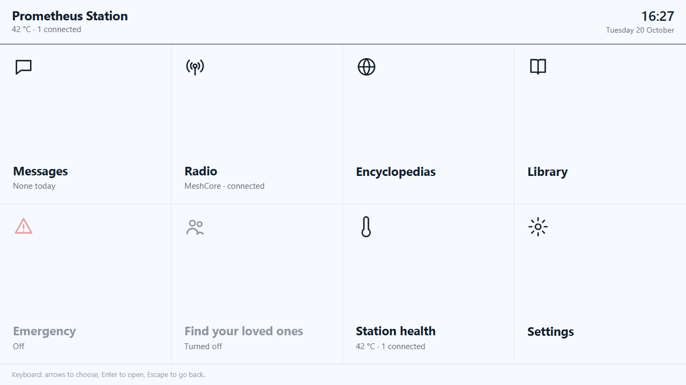
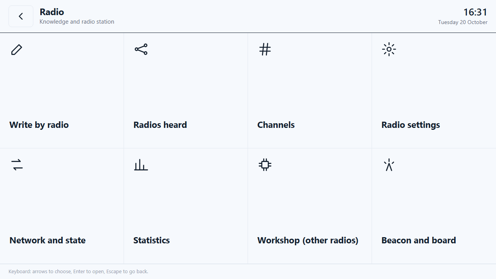
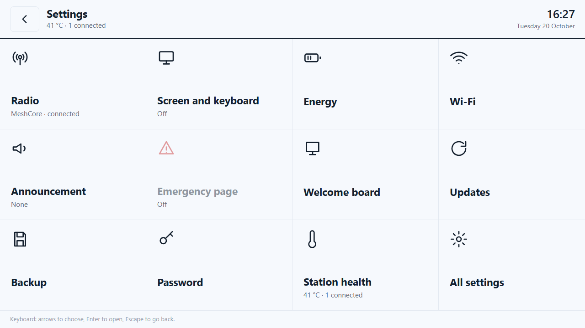
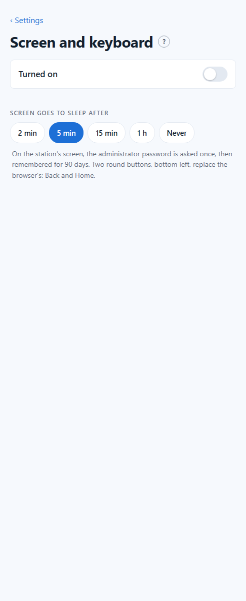

# 19. A screen and a keyboard on the station

*Towards the case.* Everything the station offers is a web page, read from a phone. Plug a **screen** and a **USB keyboard** into the Pi and the station shows its own pages full screen: the message board, the radio, the encyclopedias, the Mesh section, **without any phone**. It is the first step towards the rugged case, where a 7-inch screen and a keyboard live in the lid.

Script: [`installation/11-ecran-local.sh`](../installation/11-ecran-local.sh)

<p>


</p>
<p>


</p>

*(Screenshots at the size of the 7-inch screen, 1280 × 720.)*

## What you need

| Part | Notes |
|---|---|
| A screen | any HDMI screen or TV on the Pi's **micro-HDMI** port (the one next to the USB-C power), or the official **Raspberry Pi Touch Display 2** (7", plugs into the display connector: it takes nothing from the e-ink screen) |
| A keyboard | any USB keyboard; French AZERTY layout. A small keyboard with a touchpad does for a mouse; with a touch screen, no mouse at all |

The screen draws power (about 2 W for the 7" one) and the browser keeps the processor busy: on battery, let it go to sleep (below).

## Install

On the Pi, from the `installation` folder (internet needed, about 1 GB with the browser):

```
Pi$ cd ~/installation
Pi$ sudo bash 11-ecran-local.sh
```

You should see, at the end:

```
== Ecran de la station installe (desactive tant qu'il n'est pas active dans Parametres > Ecran et clavier)
```

Nothing shows on the screen yet: like every function of the station, it is **off at first**.

## Big tiles, for fingers and for the keyboard

On the station's screen, the home page is made of **big tiles** (`/ecran/`), so that everything a phone does is two touches away, Settings included, even in the middle of a forest:

| Screen | Tiles |
|---|---|
| **Home** | Messages · Radio · Encyclopedias · Library · Emergency · Find your loved ones · Station health · Settings |
| **Radio** | Write by radio · Radios heard · Channels · Radio settings · Network and state · Statistics · Workshop · Beacon and board |
| **Settings** | Radio · Screen and keyboard · Energy · Wi-Fi · Announcement · Emergency page · Welcome board · Updates · Backup · Password · Station health · All settings |

Each tile opens the station's real page directly (the Settings tiles open the right section). Tiles show what matters live: the radio connected and its network, today's messages, the temperature and people connected, a function turned off is greyed out. Always at the top: the station's name, the time in large, and a big back button.

**With the keyboard alone**, no mouse needed: the arrows move between tiles, **Enter** opens, **Escape** goes back.

It also works on a phone or a computer (two columns on a phone): `http://<station>.local/ecran/`. Nothing links to it from the other pages yet.

> *Next, once tried on the real screen:* the pages opened from the tiles made larger for fingers on this screen only, and an on-screen keyboard (AZERTY, accents) to write without the real one: on Linux, the browser has none.

## Turn it on

**Settings › Station › Screen and keyboard › Turned on.** Within a few seconds the screen shows the big-tile home page, full screen. **Screen goes to sleep after**: 2 min, 5 min (at first), 15 min, 1 h or never; a touch or a key wakes it up.

- There is no browser bar: two round buttons, bottom left, **Back** and **Home** (the tiles), are on every page, encyclopedia articles included. They appear only on the station's own screen, never on phones.
- The pages are in French; the English flag on the home page switches them, as on a phone.
- Writing on the message board needs no password, as for everyone. The **administrator pages** (Settings, Mesh section) ask for the password once on this screen, then remember it for 90 days, like any phone. Anyone standing at the station could then use them: if that matters, change the password (Settings › Password), which signs every device out.
- The **low-power mode** (Settings › Energy) normally switches the USB ports off; it keeps them on while the screen is turned on, so the keyboard keeps working.

## How it works inside

| Part | Role |
|---|---|
| `cage` | a minimal display server that shows one window, full screen, and nothing else: no desktop to maintain |
| `chromium` | the browser, in kiosk mode, opening `http://localhost/ecran/?kiosque=1` (the tiles), in its own profile (`/var/lib/prometheus-kiosque/chromium`) |
| `/ecran/` | the big-tile home page (`web/ecran/index.html`): three screens, live information, arrow keys |
| `prometheus-kiosque` | started by `cage`: arms the sleep (`swayidle`), then starts the browser. Sleep switches the screen's output off with `wlr-randr` (this `cage` does not support the usual screen power protocol) |
| `prometheus-kiosque.service` | runs it as a dedicated user `kiosque`, with no password and no access to the rest of the station, on its own console |
| `prometheus-ecran-local` (+ `.path`, `.service`) | applies the setting when it changes and at start-up: starts or stops the screen, restarts the browser only when the screen or its sleep delay changed, and makes the low-power mode re-check the USB ports |
| `prometheus-admin` | the `ecran` settings section (`active`, `veille` in minutes) |

The two buttons are added by `langue.js` and `annonce.js` when the page was opened with `?kiosque=1` (remembered by that browser only).

## Tested, and not

**Tested on the station, with a virtual screen** (the same software, a 1280 × 720 screen in memory): turning it on from the Settings started the screen by itself; the home page, the message board (with *Also send by radio*), the encyclopedias, and the password page in front of the Mesh section, all full screen, in French, with the two buttons; sleep after the chosen delay (the output switched off, the browser still running) and waking up with a key; turning it off from the Settings; the low-power mode keeping the USB ports with the screen on.

**The tiles**, on the station at 1280 × 720 and phone width: the three screens with the station's live information, functions turned off greyed out, and the arrow keys (Messages → right → Radio → down → Find your loved ones).

**Not yet tested:** a real HDMI screen and keyboard (the next step), the official 7" touch screen, heat in a closed case with the browser running.

## Troubleshooting

| Problem | Check |
|---|---|
| Settings › *Not installed yet* | run `sudo bash 11-ecran-local.sh` with internet |
| Nothing on the screen | *Turned on* in Settings? The screen plugged in **before** turning it on, on the micro-HDMI port next to the power? `systemctl status prometheus-kiosque` |
| The screen stays black after a while | it is asleep: touch it or press a key |
| The keyboard types QWERTY | the layout is set when the screen starts: turn the screen off and on again in Settings |
| The keyboard does nothing in low-power mode | the screen must be *Turned on*: then the USB ports stay on |
| What the screen did | `sudo journalctl -u prometheus-kiosque -n 50` |

Next: the case itself is in the [Reference](REFERENCE.md#status-october-2026).
